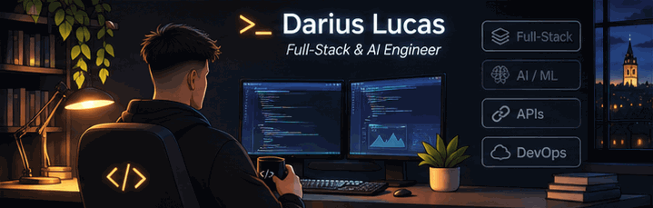

## Hey 👋, I'm Darius

**Full-Stack & AI Engineer** based in Cluj-Napoca, Romania. I build full-stack products with practical AI — from interfaces and APIs to intelligent features and ML pipelines.

## ⚡ A Few Quick Facts

- 🏦 **Former Full-Stack Engineering Intern at Raiffeisen Bank** — our AI-powered banking project placed **2nd** in its final evaluation.
- 🤖 Building with **LLMs, AI agents, RAG, MCP**, and machine learning.
- 🔧 Comfortable across **frontend, backend, databases, and APIs**.
- 🧠 Currently exploring **transformers, LLM architecture, and model evaluation**.

## 🛠️ Tools I Use

## 📌 Stuff I've Made

- **[MatchMind](https://github.com/DariusLucas/MatchMind)** — AI football analytics with natural-language queries, ML predictions, and LLM evaluation.
- **[Replens](https://portfolio-darius-lucas.vercel.app/)** — AI fitness coaching with live-camera movement analysis; coordinated an eight-person team's frontend work. *(Portfolio project)*
- **[Carina Beauty](https://carinabeauty.ro/)** — production Next.js website bringing in approximately **15–20 new appointments/month**.
- **[Safety Center](https://portfolio-darius-lucas.vercel.app/)** — mobile banking internship project integrating AI agents, voice, and camera-based product discovery. *(Private code)*
